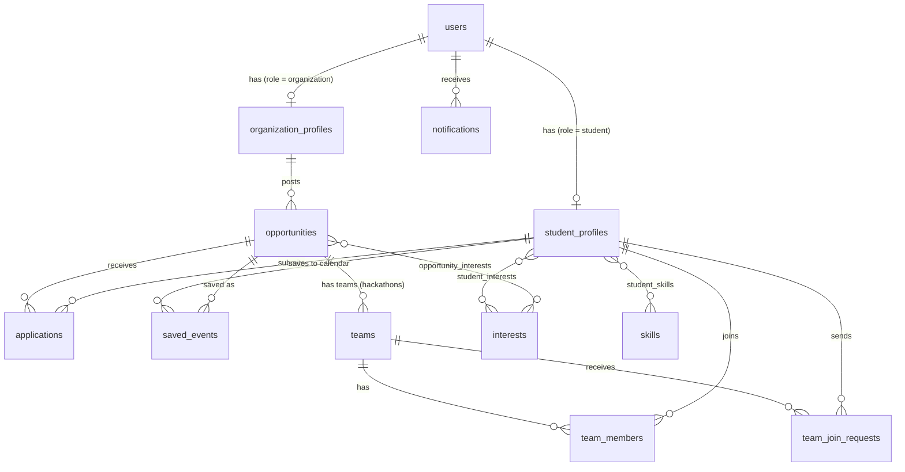

# Bloom database schema

15 tables. The SQL is in `backend/database/schema.sql`; the Python models are in `backend/app/models.py`.
**If you change one, change the other** (and open a pull request that mentions the Database Engineer).

## Tables

| Table | Purpose |
|---|---|
| `users` | Login account for every role (`student`, `organization`, `admin`). Passwords are stored as hashes only. |
| `student_profiles` | The LinkedIn-style student page (no CV upload). `looking_for_team` makes a student visible in hackathon teammate search. |
| `interests`, `skills` | Lookup lists. Linked to students (`student_interests`, `student_skills`) and to opportunities (`opportunity_interests`) so search can filter by interest. |
| `organization_profiles` | Company details. `approval_status` is `pending` until an admin approves. |
| `opportunities` | Hackathons, internships, co-ops, volunteering, workshops, seminars. `status` is `pending` -> `approved` / `rejected` by an admin. Indexed on status+type, city, start date and deadline for fast filtering. |
| `applications` | A student applying to an opportunity. One application per student per opportunity (unique key). |
| `saved_events` | The student's personal calendar. `remind_at` drives reminder notifications. |
| `teams`, `team_members`, `team_join_requests` | Team formation for hackathons and group projects. |
| `notifications` | In-app alerts: application updates, event reminders, team requests, approval results. |

## Rules the application code must enforce
These cannot be expressed in SQL alone:
- `student_profiles.user_id` must belong to a user with role `student`; `organization_profiles.user_id` to role `organization`.
- Only `approved` organizations can post, and only `approved` opportunities are shown to students.
- A team cannot exceed `max_members`; the team leader is also inserted into `team_members` with role `leader`.
- Deleting a user deletes their profile, applications, calendar entries and notifications (cascade).

### email_verifications
Stores the one-time password (OTP) sent to a student's email when registering.
The code is stored hashed, never as plain text.

| Column     | Type         | Notes                                      |
|------------|--------------|--------------------------------------------|
| id         | INT          | Primary key                                |
| user_id    | INT          | Foreign key to users(id)                   |
| code_hash  | VARCHAR(255) | Hashed OTP                                 |
| expires_at | DATETIME     | When the code stops working                |
| attempts   | TINYINT      | Number of wrong guesses so far             |
| is_used    | BOOLEAN      | True once the code has been verified       |
| created_at | DATETIME     | When the code was created                  |